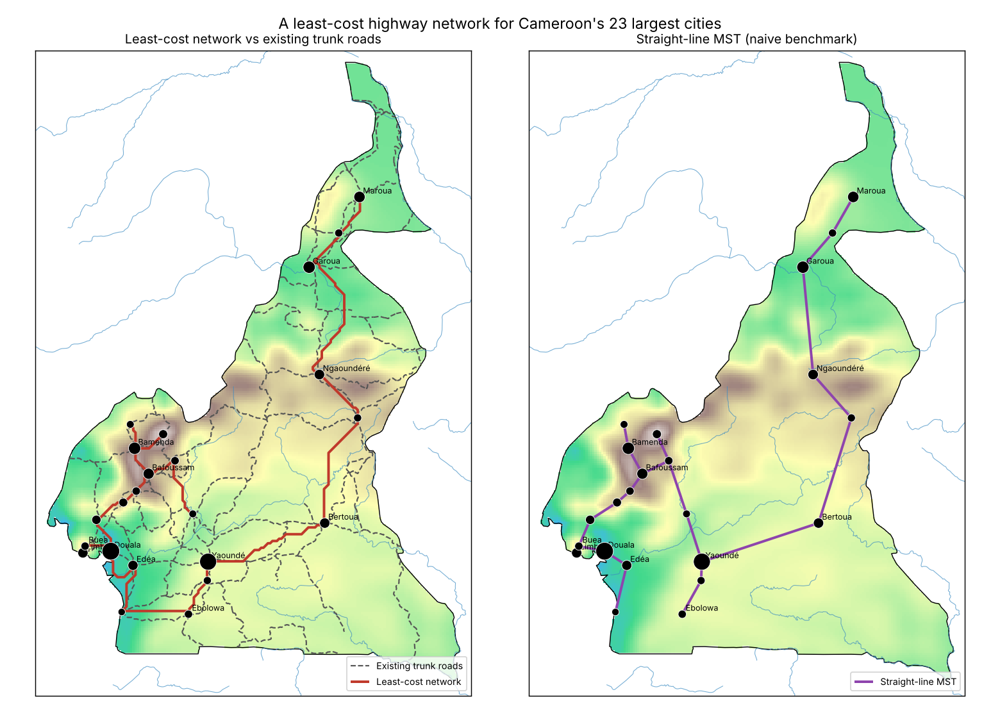
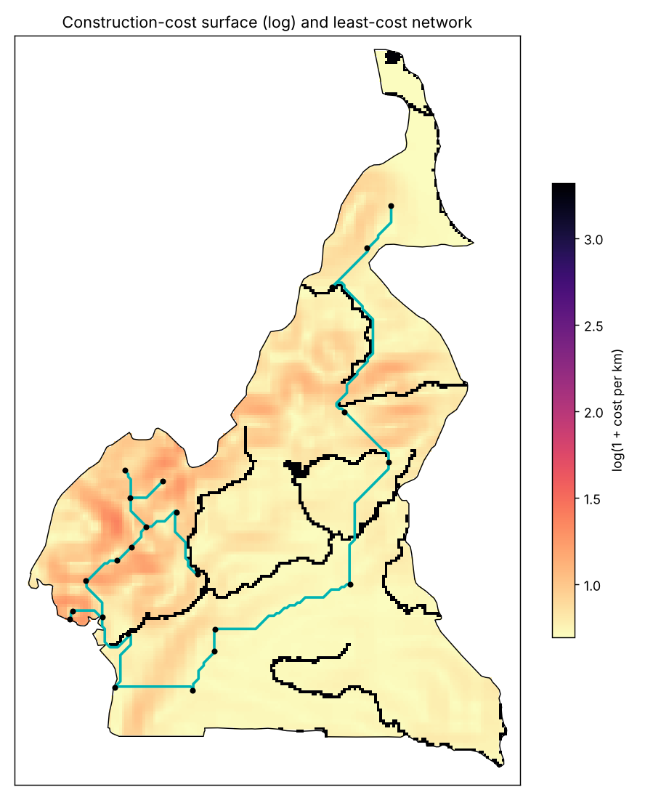
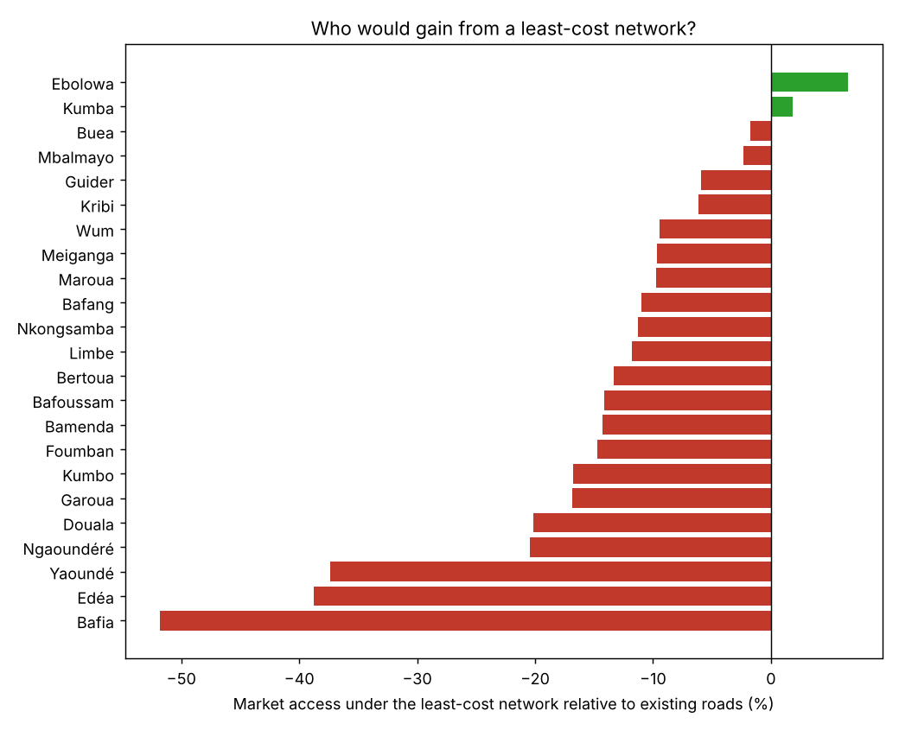

# A Least-Cost Highway Network for Cameroon

If a planner had to connect the 23 largest cities of Cameroon at the lowest construction cost,
which network would she build? This project computes that network, compares it with the main roads
that exist today and measures which cities would gain or lose access to markets.

The approach follows the "least-cost spanning network" of Faber (2014), used to build a
counterfactual of the Chinese highway system, with construction costs based on terrain as in recent
work on African road networks (for example by Carl Müller-Crepon and co-authors).



## Method

1. **Cost map.** Cameroon is cut into cells of about 4.6 km. The cost of building one km in a cell is
   `1 + 0.5 x slope (%) + 25 if the cell contains a river or a lake`. Cells outside Cameroon cannot
   be used.
2. **Cheapest path between each pair of cities**, with the Dijkstra algorithm on the grid.
3. **Minimum spanning tree** with the Kruskal algorithm: the cheapest set of links that connects all
   the cities. This is the least-cost network (LCN). The same tree computed with straight lines is used
   as a simple benchmark.
4. **Market access** of each city: `MA(i) = sum over j of Population(j) / T(i, j)`, where `T(i, j)` is
   the cheapest travel cost between i and j. Moving on a road costs 1 per km, moving off-road costs 5
   per km (more on slopes). Computed with no roads, today's roads, the LCN and the straight-line tree.

## Algorithms

```
DIJKSTRA (grid, start)
    dist <- infinity for every cell ; dist[start] <- 0
    queue <- {(0, start)}
    WHILE queue is not empty
        take the cell with the smallest distance
        FOR each of its 8 neighbours
            step <- length (side or diagonal) x (cost of the cell + cost of the neighbour) / 2
            IF dist[cell] + step < dist[neighbour] THEN
                dist[neighbour] <- dist[cell] + step ; remember where we came from
    RETURN dist

KRUSKAL (cities, links with their cost)
    sort the links from the cheapest to the most expensive
    each city starts in its own group
    FOR each link (i, j) in this order
        IF i and j are not in the same group THEN keep the link and merge the two groups
    RETURN the kept links (number of cities - 1)
```

Both algorithms are written by hand in `src/graph_algorithms.py`.

## Results

### The cheapest network

| Network | Links | Length | Construction cost (index) | Cost per km | Share within 10 km of an existing road |
|---|---|---|---|---|---|
| Least-cost network | 22 | 2,288 km | 2,987 | 1.31 | 63% |
| Straight-line tree | 22 | 1,983 km | 5,233 | 2.64 | 74% |
| Existing main roads | 247 segments | 10,068 km | | | |

- The straight-line tree is 13% shorter but would cost 75% more to build, because it goes straight
  over the Western Highlands and the Adamawa plateau and crosses rivers where they are wide. The LCN
  avoids these areas: for example it reaches Kumbo from Bamenda and not from Foumban, and its paths
  follow the valleys.
- 63% of the LCN is within 10 km of an existing road. The main corridors of Cameroon are close to
  the cheapest routes, in particular in the West (Douala, Bafoussam, Bamenda) and in the North
  (Ngaoundéré, Garoua, Maroua).
- The network changes little with the cost parameters: with a slope weight from 0 to 1 or a water
  cost from 5 to 50, at least 19 of the 22 links stay the same (`results/sensitivity.csv`).



### Market access

| Scenario | Gain vs no road (population-weighted) | Length | Gain per 1,000 km |
|---|---|---|---|
| Existing main roads | +371% | 10,068 km | 37 points |
| Least-cost network | +275% | 2,288 km | 120 points |
| Straight-line tree | +278% | 1,983 km | 140 points |

- The LCN gives about three quarters of the gain of today's roads with less than a quarter of their
  length.
- But a tree that only minimises cost does not link Douala and Yaoundé directly. The path goes
  Douala, Edéa, Kribi, Ebolowa, Mbalmayo, Yaoundé, because a spanning tree ignores traffic. With the
  LCN, Yaoundé (-37%), Edéa (-39%) and Bafia (-52%) would have much less market access than today,
  while Kumba and Ebolowa would gain a little.



The existing network is close to what cost minimisation predicts. Where it differs, as on the
Douala to Yaoundé corridor, traffic justifies extra links. This is why Faber uses the LCN as an
instrument: it predicts which places get a road for cost reasons, independently of their economic
potential.

## Limits

The terrain grid is coarse (Mount Cameroon appears below 2,000 m), only major rivers are included,
populations are Natural Earth estimates and travel costs are not calibrated on real travel times.
Possible extensions: SRTM 90 m terrain, OpenStreetMap roads, a network weighted by traffic, and use of
the LCN as an instrument in a regression on local development (night lights, census data).

## Run it

```bash
pip install -r requirements.txt
python run_analysis.py      # about 30 seconds
```

```
src/graph_algorithms.py                     Dijkstra on a grid, Kruskal minimum spanning tree
run_analysis.py                             cost map, networks, market access, sensitivity, maps
data/cities.geojson                         23 cities above 50,000 inhabitants (Natural Earth)
data/cameroon_boundary.geojson              national border (Natural Earth)
data/existing_roads_natural_earth.geojson   main roads (Natural Earth 1:10m)
data/rivers.geojson, data/lakes.geojson     rivers and lakes (Natural Earth 1:10m)
data/topography_10arcmin_cameroon.nc        topography (fatiando-data, ETOPO1 at 10 arc-minutes)
results/, figures/                          outputs
```

Reference: Faber, B. (2014). Trade Integration, Market Size, and Industrialization: Evidence from
China's National Trunk Highway System. Review of Economic Studies, 81(3), 1046-1070.

Author: Klaus KUEKOU
